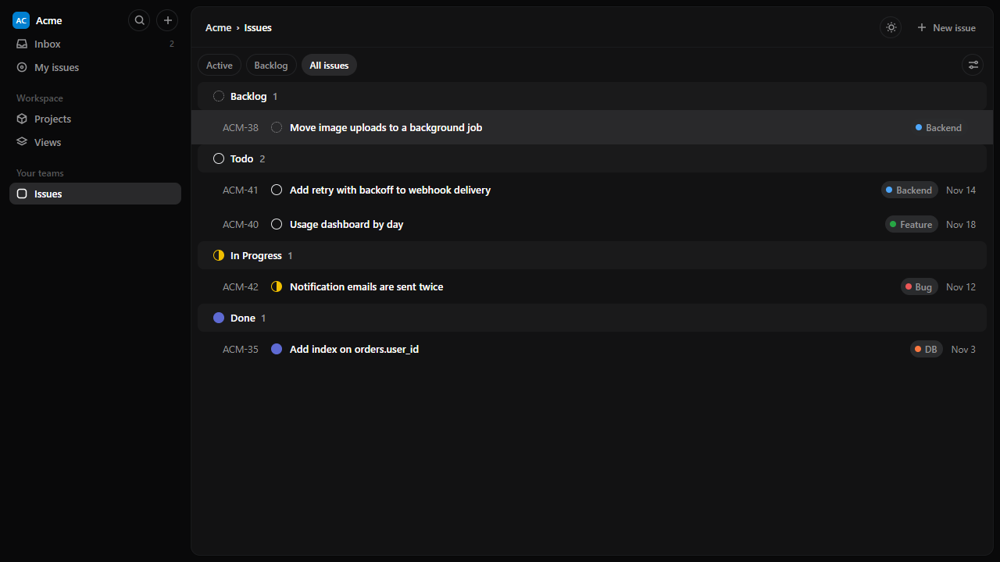
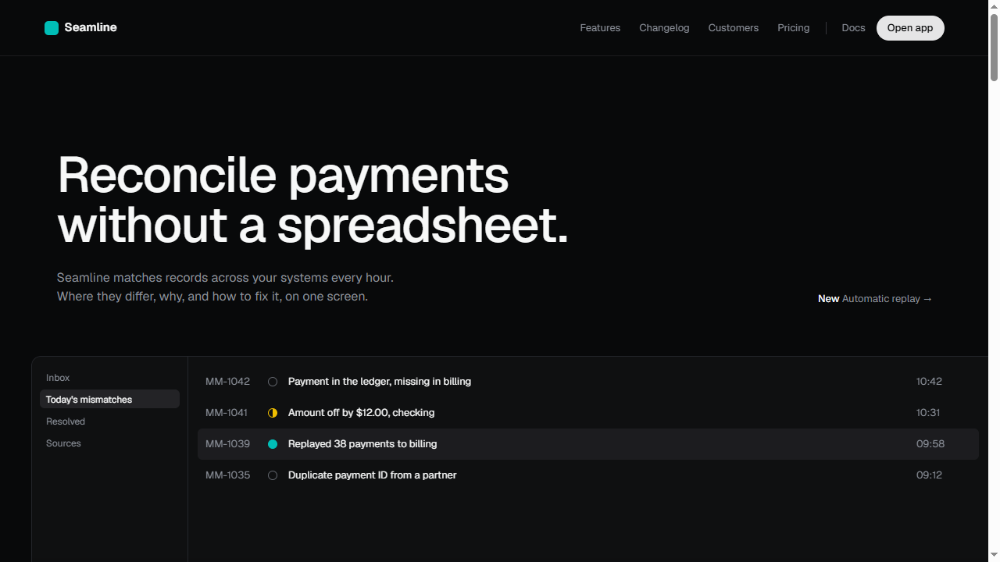

# agent-skills

Agent Skills by [@TriSBie](https://github.com/TriSBie) for Claude Code and other agents that read `SKILL.md`.

| Skill | What it does |
|---|---|
| [dense-tool-ui](skills/dense-tool-ui) | Measured layout, interaction and color reference for dense, keyboard-first work tools and their dark landing pages, with two runnable templates. |
| [vercel-dashboard-crm](skills/vercel-dashboard-crm) | Build a CRM or dashboard-management website in the design language of the live Vercel team dashboard: 254px sidebar + 56px top bar, #fafafa canvas, 13–14px dense type, black primary buttons, one blue link accent, grid/list toggle, usage and alerts panels — with verified measurements, CRM mappings, and the pass-3 interaction spec. |

## Install

**Claude Code (plugin marketplace)**

```
/plugin marketplace add TriSBie/agent-skills
/plugin install trisbie-skills@trisbie-agent-skills
```

**Any agent (copy the folder)**

```bash
git clone https://github.com/TriSBie/agent-skills
cp -r agent-skills/skills/dense-tool-ui ~/.claude/skills/
cp -r agent-skills/skills/vercel-dashboard-crm ~/.claude/skills/
```

## dense-tool-ui




- `SKILL.md`: workflow and rules (short, always loaded).
- `references/`: exact sizes, tokens and page anatomy, read on demand.
- `assets/`: `app-template.html` and `landing-template.html`, single files with no build step. Open either with `?selftest` and the tab title should read `SELFTEST OK <n>`.

Measurements were taken from a live product in November 2026 and will drift as that product changes. The skill copies structure and behavior only: no logos, names, illustrations or copy from the source.

## vercel-dashboard-crm

- `SKILL.md`: workflow and rules (short, always loaded).
- `references/`: verified dashboard measurements, design tokens, public Geist scales, project-detail patterns, and the pass-3 interaction spec (menus, Cmd+K, notifications, dialogs, skeletons, disabled states), read on demand.
- `skill.yaml`: Muse metadata for the skill.

Measurements were taken live from the Vercel team dashboard in November 2026 and will drift as that product changes. The skill copies structure and behavior only: no logos, names, illustrations or copy from the source. One rule from the build: no shell controls — every menu item must lead to a real screen, a real link, or a real action, never a placeholder popup.

## Checks

`node scripts/check.mjs` checks WCAG AA contrast for every `tokens.json` and runs every template's `?selftest` in headless Chrome. GitHub Actions runs it on each push and pull request.

## License

MIT. Not affiliated with, or endorsed by, Linear or Vercel. Product names are used only to describe the style being measured.
